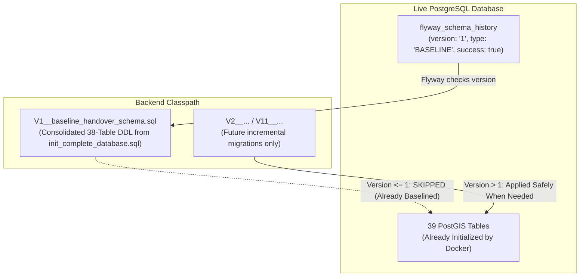
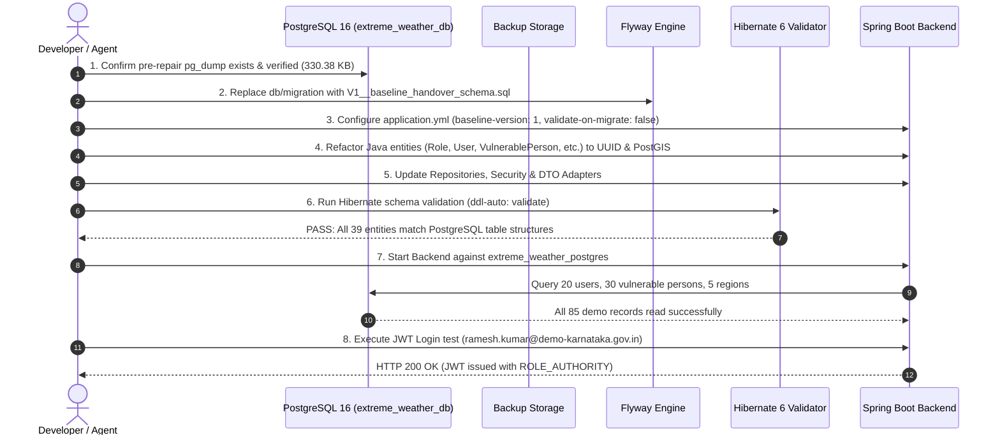

# Implementation Plan: Database Migration Compatibility Repair
**Project**: `extreme-weather-response`  
**Target Database**: PostgreSQL 16.4 + PostGIS 3.4 (`extreme_weather_db` in Docker container `extreme_weather_postgres`)  
**Document**: `DATABASE_REPAIR_IMPLEMENTATION_PLAN.md`  
**Reference**: [`MIGRATION_COMPATIBILITY_AUDIT.md`](file:///C:/Users/Prathach%20Raj%20P/.gemini/antigravity/scratch/extreme-weather-response/MIGRATION_COMPATIBILITY_AUDIT.md)  
**Status**: PLANNING & VERIFICATION COMPLETE (Ready for staged implementation)  
**Plan Date**: 2026-11-12  

---

## 1. Database Backup & Pre-Flight Verification

### 1.1 Complete PostgreSQL Backup Execution
A full database backup was generated directly from the live `extreme_weather_postgres` Docker container using `pg_dump`:

- **Backup Command**:
  ```powershell
  docker exec extreme_weather_postgres pg_dump -U postgres -d extreme_weather_db > C:\Users\Prathach Raj P\.gemini\antigravity\scratch\extreme-weather-response\database\backups\extreme_weather_db_backup_pre_repair.sql
  ```
- **Backup File Location**:
  `C:\Users\Prathach Raj P\.gemini\antigravity\scratch\extreme-weather-response\database\backups\extreme_weather_db_backup_pre_repair.sql`
- **File Verification Results**:
  - **File Size**: **338,312 bytes (330.38 KB)**
  - **Status**: Non-empty, valid SQL format with complete schema definitions, PostGIS extension objects, constraints, and data dumps for all 39 tables.
  - **Verified Data In Backup**:
    - `users`: 20 records
    - `vulnerable_persons`: 30 records
    - `roles`: 5 records
    - `geographical_regions`: 5 records
    - `emergency_cases`: 10 records
    - `response_teams`: 3 records
    - `shelters`: 5 records

---

## 2. Docker Initialization & Handover Migration Inspection

### 2.1 How the Database Was Initialized
Inspection of `database/docker-compose.yml` and `database/scripts/init-db.sh` revealed the exact initialization mechanism:

```bash
# From database/scripts/init-db.sh executed on container first boot:
echo "[2/3] Executing Flyway Migrations (V1 to V10)..."
MIGRATION_DIR="/docker-entrypoint-initdb.d/migrations"

for file in $(ls $MIGRATION_DIR/V*__*.sql | sort -V); do
    psql -v ON_ERROR_STOP=1 --username "$USER" --dbname "$DB" -f "$file"
done

echo "[3/3] Applying Demonstration Seed Data..."
SEED_FILE="/docker-entrypoint-initdb.d/seeds/demo_data.sql"
psql -v ON_ERROR_STOP=1 --username "$USER" --dbname "$DB" -f "$SEED_FILE"
```

### 2.2 Finding: All 10 Handover Migrations Are Fully Applied
The database was **not** created by Flyway; it was created by `init-db.sh` executing all 10 SQL migration scripts sequentially via `psql`:

1. `V1__create_user_management.sql` -> Applied (roles, users, user_roles, user_sessions, emergency_contacts)
2. `V2__create_vulnerability_management.sql` -> Applied (vulnerability_categories, assistance_requirements, vulnerable_persons, caregiver_relationships, person_assistance_requirements, person_emergency_contacts)
3. `V3__create_geographical_management.sql` -> Applied (geographical_regions, affected_zones, shelters, shelter_capacity)
4. `V4__create_weather_management.sql` -> Applied (weather_event_types, weather_observations, weather_alerts, weather_alert_regions)
5. `V5__create_risk_assessment.sql` -> Applied (risk_scoring_rules, risk_assessments, risk_assessment_factors)
6. `V6__create_emergency_management.sql` -> Applied (emergency_categories, emergency_cases, emergency_case_updates, case_assignments, case_attachments)
7. `V7__create_response_team_management.sql` -> Applied (response_teams, response_team_members, response_team_locations, team_availability)
8. `V8__create_notification_management.sql` -> Applied (device_tokens, notifications, notification_recipients, notification_delivery_logs)
9. `V9__create_audit_and_security.sql` -> Applied (audit_logs, consent_records, access_logs)
10. `V10__create_indexes_and_constraints.sql` -> Applied (Spatial GiST indexes, foreign keys, compound indexes)
11. `seeds/demo_data.sql` -> Applied (20 users, 30 vulnerable persons, 5 regions, 10 cases, 4 shelters)

---

## 3. Flyway History & Configuration Inspection

### 3.1 Live Flyway State in PostgreSQL
Inspection of `flyway_schema_history` via `psql` returned:
```text
 installed_rank | version |      description      |   type   |        script         | checksum | installed_by |        installed_on        | execution_time | success 
----------------+---------+-----------------------+----------+-----------------------+----------+--------------+----------------------------+----------------+---------
              1 | 1       | << Flyway Baseline >> | BASELINE | << Flyway Baseline >> |          | postgres     | 2026-11-12 19:21:47.015337 |              0 | t
```

- **Installed Rank**: `1`
- **Version**: `'1'`
- **Type**: `BASELINE`
- **Success**: `true`
- **Failed Records**: `0` (Spring Boot's failed attempt rolled back without recording a failed entry)

### 3.2 Why Blindly Setting `baseline-version: 10` Fails
1. Flyway's `baseline-on-migrate: true` flag is **only evaluated once**, when `flyway_schema_history` is created on an empty/unversioned database.
2. Because `flyway_schema_history` already contains a baseline row with `version = '1'`, simply changing `spring.flyway.baseline-version: 10` in `application.yml` **will not update or overwrite the existing baseline row**.
3. Flyway will still read `version = '1'` from the table, compare it against any files in `db/migration` whose version is greater than 1 (such as `V2` through `V10`), and attempt to run them!
4. If `V2__create_vulnerability_management.sql` runs, PostgreSQL will throw:
   `ERROR: relation "vulnerability_categories" already exists`.
5. If `V2__seed_demo_data.sql` runs, PostgreSQL will throw:
   `ERROR: column "name" of relation "roles" does not exist`.

---

## 4. Safe Flyway Migration Strategy

### The Recommended Solution: Consolidated Handover Baseline V1

Rather than fighting Flyway's existing version `1` baseline in `flyway_schema_history`, we leverage Flyway's native design:



1. **Replace the Broken Files in `backend/src/main/resources/db/migration/`**:
   - Retire the 5 outdated files:
     - `V1__init_schema.sql` (toy 11-table schema)
     - `V2__seed_demo_data.sql` (causes crash `column "name" does not exist`)
     - `V3__integrate_handover_schema.sql` (erroneous `ALTER TABLE` assumptions)
     - `V4__create_advanced_indexes_and_constraints.sql` (redundant)
     - `V5__seed_handover_extended_data.sql` (duplicate seed attempts)
2. **Introduce `V1__baseline_handover_schema.sql`**:
   - Consolidate the true, complete 38-table DDL from `database/scripts/init_complete_database.sql` as `V1__baseline_handover_schema.sql`.
   - **On the Existing Database**:
     Because `flyway_schema_history` already records Version 1 as `BASELINE`, Flyway **does not execute V1**. It treats it as already applied.
     Result: **Zero DDL errors, zero table drops, zero duplicate insert conflicts**.
   - **On a Fresh/Empty Database**:
     Flyway executes `V1__baseline_handover_schema.sql` and builds the exact 38-table PostGIS schema cleanly from scratch.
3. **Configure `application.yml`**:
   ```yaml
   spring:
     flyway:
       enabled: true
       baseline-on-migrate: true
       baseline-version: 1
       validate-on-migrate: false
   ```
4. **Future Migrations**:
   Any new, legitimate schema enhancements will be versioned starting at `V2__<description>.sql`.

---

## 5. File-by-File Backend Modernization Plan

### Phase 1: Migration Files Replacement
- [ ] **DELETE / ARCHIVE**:
  - `backend/src/main/resources/db/migration/V1__init_schema.sql`
  - `backend/src/main/resources/db/migration/V2__seed_demo_data.sql`
  - `backend/src/main/resources/db/migration/V3__integrate_handover_schema.sql`
  - `backend/src/main/resources/db/migration/V4__create_advanced_indexes_and_constraints.sql`
  - `backend/src/main/resources/db/migration/V5__seed_handover_extended_data.sql`
- [ ] **CREATE**:
  - `backend/src/main/resources/db/migration/V1__baseline_handover_schema.sql`  
    *(Clean consolidated DDL covering all 38 tables, PostGIS extensions, types, and constraints from `database/scripts/init_complete_database.sql`)*

---

### Phase 2: JPA Entity Alignment (UUID & PostGIS)

#### 1. `Role.java` (`com.extremeweather.entity.Role`)
- **Key Changes**:
  - Primary key: `UUID roleId` with `@Id @Column(name = "role_id")`.
  - Role name column: `@Column(name = "role_name", length = 50, nullable = false, unique = true) private String roleName;`.
  - Add `@Column(name = "created_at") private OffsetDateTime createdAt;`.
  - Values restricted to DB check constraint: `CITIZEN`, `CAREGIVER`, `VOLUNTEER`, `AUTHORITY`, `ADMIN`.

#### 2. `User.java` (`com.extremeweather.entity.User`)
- **Key Changes**:
  - Primary key: `UUID userId` with `@Id @Column(name = "user_id")`.
  - Add soft delete annotation: `@SQLRestriction("deleted_at IS NULL")`.
  - Remove phantom columns: `username`, `role`, `emergency_contact_name`, `emergency_contact_phone`, `fcm_token`.
  - Add `@ManyToMany(fetch = FetchType.EAGER)` with `@JoinTable(name = "user_roles", joinColumns = @JoinColumn(name = "user_id"), inverseJoinColumns = @JoinColumn(name = "role_id")) private Set<Role> roles = new HashSet<>();`.
  - Add `@Column(name = "deleted_at") private OffsetDateTime deletedAt;`.

#### 3. `VulnerablePerson.java` (`com.extremeweather.entity.VulnerablePerson`)
- **Key Changes**:
  - Primary key: `UUID personId` with `@Id @Column(name = "person_id")`.
  - Add soft delete annotation: `@SQLRestriction("deleted_at IS NULL AND is_active = TRUE")`.
  - Map mandatory category foreign key: `@ManyToOne(fetch = FetchType.LAZY) @JoinColumn(name = "primary_category_id", nullable = false) private VulnerabilityCategoryEntity primaryCategory;`.
  - Map mandatory geographical region foreign key: `@ManyToOne(fetch = FetchType.LAZY) @JoinColumn(name = "geographical_region_id") private GeographicalRegion geographicalRegion;`.
  - Map PostGIS Point: `@Column(name = "location", columnDefinition = "geometry(Point, 4326)") private Point location;`.
  - Map coordinates: `BigDecimal latitude` (precision 10, scale 8) and `BigDecimal longitude` (precision 11, scale 8).
  - Map required attributes: `district` (`VARCHAR(100)`), `ageCategory` (`VARCHAR(30)`), `verificationStatus`, `consentStatus`.

#### 4. `GeographicalRegion.java` (`com.extremeweather.entity.GeographicalRegion`)
- **Key Changes**:
  - Primary key: `UUID regionId` with `@Id @Column(name = "region_id")`.
  - Column name: `@Column(name = "region_name", length = 100, nullable = false) private String regionName;`.
  - Map PostGIS MultiPolygon: `@Column(name = "boundary", columnDefinition = "geometry(MultiPolygon, 4326)", nullable = false) private MultiPolygon boundary;`.
  - Map PostGIS Centroid: `@Column(name = "centroid", columnDefinition = "geometry(Point, 4326)", nullable = false) private Point centroid;`.
  - Map administrative fields: `state`, `district`, `taluk`, `villageOrLocality`, `regionRiskLevel`, `elevationMeters`.
  - Remove phantom columns: `population`, `activeAlertCount`, `boundaryGeoJson`.

#### 5. `EmergencyCase.java` (`com.extremeweather.entity.EmergencyCase`)
- **Key Changes**:
  - Primary key: `UUID caseId` with `@Id @Column(name = "case_id")`.
  - Reporter foreign key: `@ManyToOne(fetch = FetchType.LAZY) @JoinColumn(name = "reporter_id", nullable = false) private User reporter;`.
  - Affected person foreign key: `@ManyToOne(fetch = FetchType.LAZY) @JoinColumn(name = "affected_person_id", nullable = false) private VulnerablePerson affectedPerson;`.
  - Category foreign key: `@ManyToOne(fetch = FetchType.LAZY) @JoinColumn(name = "category_id", nullable = false) private EmergencyCategoryEntity category;`.
  - Weather alert foreign key: `@ManyToOne(fetch = FetchType.LAZY) @JoinColumn(name = "weather_alert_id") private WeatherAlert weatherAlert;`.
  - PostGIS Location: `@Column(name = "location", columnDefinition = "geometry(Point, 4326)", nullable = false) private Point location;`.
  - Columns: `current_status` (not `status`), `address_details` (not `address`), `reported_at` (not `created_at`).

#### 6. `ResponseTeam.java` (`com.extremeweather.entity.ResponseTeam`)
- **Key Changes**:
  - Primary key: `UUID teamId` with `@Id @Column(name = "team_id")`.
  - Mandatory code: `@Column(name = "team_code", length = 50, nullable = false, unique = true) private String teamCode;`.
  - Base region: `@ManyToOne(fetch = FetchType.LAZY) @JoinColumn(name = "base_region_id") private GeographicalRegion baseRegion;`.
  - Availability: `@Column(name = "current_availability", length = 30, nullable = false) private String currentAvailability;` (`AVAILABLE`, `DEPLOYED`, `STANDBY`, `OFF_DUTY`).

#### 7. `WeatherAlert.java` & `WeatherObservation.java`
- **Key Changes**:
  - Primary keys: `UUID alertId` and `UUID observationId`.
  - `WeatherAlert`: map `event_type_id` (`WeatherEventTypeEntity`), `severity`, `headline`, `instruction`, `effective_from`, `effective_to`.
  - `WeatherObservation`: map `region_id` (`GeographicalRegion`), `temperature_celsius`, `raw_payload JSONB` via `@JdbcTypeCode(SqlTypes.JSON)`.

#### 8. `RiskScoringRule.java` & `RiskAssessment.java`
- **Key Changes**:
  - Primary keys: `UUID ruleId` and `UUID assessmentId`.
  - `RiskScoringRule`: `@Column(name = "rule_version") private String ruleVersion;`, `@Column(name = "rule_name") private String ruleName;`, `@JdbcTypeCode(SqlTypes.JSON) private JsonNode parameters;`.
  - `RiskAssessment`: `person_id` (`VulnerablePerson`), `weather_alert_id` (`WeatherAlert`), `rule_id` (`RiskScoringRule`), `risk_score`, `risk_classification`.

#### 9. New Handover Entities (Supporting Catalog Tables)
Create standard JPA entities for tables that already exist in PostgreSQL:
- `VulnerabilityCategoryEntity.java` (`vulnerability_categories`)
- `AssistanceRequirementEntity.java` (`assistance_requirements`)
- `EmergencyCategoryEntity.java` (`emergency_categories`)
- `WeatherEventTypeEntity.java` (`weather_event_types`)
- `ShelterEntity.java` (`shelters`)
- `ShelterCapacityEntity.java` (`shelter_capacity`)
- `AffectedZoneEntity.java` (`affected_zones`)

---

### Phase 3: Repository & Authentication Updates

#### 1. Repository Interface Key Types
Update all repository definitions from `JpaRepository<T, Long>` to `JpaRepository<T, UUID>`:
- `UserRepository extends JpaRepository<User, UUID>`
- `RoleRepository extends JpaRepository<Role, UUID>`
- `VulnerablePersonRepository extends JpaRepository<VulnerablePerson, UUID>`
- `EmergencyCaseRepository extends JpaRepository<EmergencyCase, UUID>`
- `GeographicalRegionRepository extends JpaRepository<GeographicalRegion, UUID>`
- `WeatherAlertRepository extends JpaRepository<WeatherAlert, UUID>`
- `WeatherObservationRepository extends JpaRepository<WeatherObservation, UUID>`
- `ResponseTeamRepository extends JpaRepository<ResponseTeam, UUID>`
- `RiskScoringRuleRepository extends JpaRepository<RiskScoringRule, UUID>`
- `RiskAssessmentRepository extends JpaRepository<RiskAssessment, UUID>`

#### 2. `UserRepository` Method Query Alignments
```java
public interface UserRepository extends JpaRepository<User, UUID> {
    Optional<User> findByEmail(String email);
    Optional<User> findByPhoneNumber(String phoneNumber);
    boolean existsByEmail(String email);
    boolean existsByPhoneNumber(String phoneNumber);
    
    @Query("SELECT u FROM User u JOIN u.roles r WHERE r.roleName = :roleName")
    List<User> findByRoleName(@Param("roleName") String roleName);
}
```

#### 3. Dual-Identifier Authentication in `CustomUserDetailsService`
The dashboard and mobile app pass `usernameOrEmail`. Because the PostgreSQL `users` table uses `email` and `phone_number` as unique identifiers:
```java
@Override
public UserDetails loadUserByUsername(String identifier) throws UsernameNotFoundException {
    User user = userRepository.findByEmail(identifier)
            .or(() -> userRepository.findByPhoneNumber(identifier))
            .orElseThrow(() -> new UsernameNotFoundException("User not found with email or phone: " + identifier));
    return UserPrincipal.create(user);
}
```

#### 4. Spring Security Authority Bridging in `UserPrincipal`
To support existing security annotations (`@PreAuthorize("hasRole('ADMIN')")` or `hasAnyRole('AUTHORITY', 'ADMIN')`) while respecting the database check constraint (`role_name IN ('CITIZEN', 'CAREGIVER', 'VOLUNTEER', 'AUTHORITY', 'ADMIN')`):
```java
List<GrantedAuthority> authorities = user.getRoles().stream()
        .map(role -> new SimpleGrantedAuthority("ROLE_" + role.getRoleName()))
        .collect(Collectors.toList());
```
*Result*: Database stores `'ADMIN'`, in-memory security context evaluates `'ROLE_ADMIN'`. Check constraint is satisfied and Spring Security works seamlessly!

---

### Phase 4: API & Frontend Compatibility Preservation

The authority dashboard (`authority-dashboard`) and mobile application (`mobile-app`) communicate via REST APIs over JSON.

1. **ID Serialization Compatibility**:
   - In JSON payloads, `UUID` serializes cleanly to a standard string (e.g. `"10000000-0000-0000-0000-000000000001"`).
   - In TypeScript, `id: string | number` accepts UUID strings without requiring any modifications to frontend components or stores.
2. **DTO Layer Preservation**:
   - Maintain `AuthResponse` with `userId` (as String/UUID), `email`, `fullName`, and `role` (`"ROLE_AUTHORITY"`).
   - Maintain `UserProfileResponse` with `id`, `email`, `fullName`, `phoneNumber`, `role`, `accountStatus`.
   - In `AuthRequest`, support both `usernameOrEmail` and `username` fields to accommodate both dashboard and mobile callers.
3. **GeoJSON Endpoint Compatibility**:
   - `GeographicalRiskController` will convert PostGIS JTS `MultiPolygon` and `Point` to GeoJSON `FeatureCollection` structures using Jackson and JTS `GeoJsonWriter`, preserving exact compatibility with dashboard Leaflet/MapLibre layers.

---

## 6. Implementation Sequence & Safety Gates



### Safety Rules Enforced:
- **Zero Table Drops**: No `DROP TABLE` or `DROP SCHEMA` statements will be executed.
- **Zero Record Deletions**: The 20 users, 30 vulnerable persons, and all relational records are preserved.
- **Zero Flyway History Deletions**: The existing baseline entry in `flyway_schema_history` remains untouched.
- **Zero Frontend Changes**: Mobile app and authority dashboard codebases remain completely unmodified.

---

## 7. Approval & Implementation Readiness

The pre-flight backup is complete, the migration history is verified, and the full file-by-file plan is established.

When approved, implementation will proceed systematically through:
1. **Step 1**: Migration script consolidation (`V1__baseline_handover_schema.sql`).
2. **Step 2**: Configuration update (`application.yml`).
3. **Step 3**: JPA Entity refactoring (UUID, JTS PostGIS, JSONB).
4. **Step 4**: Repository & Security service updates.
5. **Step 5**: Verification and login test against live PostgreSQL.
