# Entity-Relationship (ER) Diagram
## Extreme Weather Vulnerability Identification and Emergency Response System

This document outlines the complete relational data architecture and entity connections for the Extreme Weather Vulnerability Identification and Emergency Response System.

### Complete Mermaid ER Diagram

```mermaid
erDiagram
    %% ==========================================
    %% USER & ACCESS MANAGEMENT
    %% ==========================================
    ROLES ||--o{ USER_ROLES : "assigned to"
    USERS ||--o{ USER_ROLES : "possesses"
    USERS ||--o{ USER_SESSIONS : "authenticates"
    USERS ||--o{ EMERGENCY_CONTACTS : "configures"

    %% ==========================================
    %% VULNERABILITY POPULATION MANAGEMENT
    %% ==========================================
    VULNERABILITY_CATEGORIES ||--o{ VULNERABLE_PERSONS : "classifies"
    USERS ||--o{ VULNERABLE_PERSONS : "registers / verifies"
    USERS ||--o{ CAREGIVER_RELATIONSHIPS : "acts as caregiver in"
    VULNERABLE_PERSONS ||--o{ CAREGIVER_RELATIONSHIPS : "managed by"
    VULNERABLE_PERSONS ||--o{ PERSON_ASSISTANCE_REQUIREMENTS : "requires"
    ASSISTANCE_REQUIREMENTS ||--o{ PERSON_ASSISTANCE_REQUIREMENTS : "specifies"
    VULNERABLE_PERSONS ||--o{ PERSON_EMERGENCY_CONTACTS : "has"

    %% ==========================================
    %% GEOGRAPHICAL & SHELTERS
    %% ==========================================
    GEOGRAPHICAL_REGIONS ||--o{ VULNERABLE_PERSONS : "contains"
    GEOGRAPHICAL_REGIONS ||--o{ WEATHER_OBSERVATIONS : "receives"
    GEOGRAPHICAL_REGIONS ||--o{ WEATHER_ALERT_REGIONS : "affected by"
    GEOGRAPHICAL_REGIONS ||--o{ RESPONSE_TEAMS : "bases"
    SHELTERS ||--|| SHELTER_CAPACITY : "tracks capacity"
    USERS ||--o{ AFFECTED_ZONES : "defines hazard perimeter"

    %% ==========================================
    %% WEATHER MONITORING
    %% ==========================================
    WEATHER_EVENT_TYPES ||--o{ WEATHER_ALERTS : "categorizes"
    WEATHER_ALERTS ||--o{ WEATHER_ALERT_REGIONS : "targets"
    USERS ||--o{ WEATHER_ALERTS : "issues"

    %% ==========================================
    %% RISK ASSESSMENT
    %% ==========================================
    RISK_SCORING_RULES ||--o{ RISK_ASSESSMENTS : "governs"
    VULNERABLE_PERSONS ||--o{ RISK_ASSESSMENTS : "evaluated in"
    WEATHER_ALERTS ||--o{ RISK_ASSESSMENTS : "triggers"
    RISK_ASSESSMENTS ||--o{ RISK_ASSESSMENT_FACTORS : "decomposes into"

    %% ==========================================
    %% EMERGENCY CASE MANAGEMENT
    %% ==========================================
    USERS ||--o{ EMERGENCY_CASES : "reports"
    VULNERABLE_PERSONS ||--o{ EMERGENCY_CASES : "subject of"
    EMERGENCY_CATEGORIES ||--o{ EMERGENCY_CASES : "categorizes"
    WEATHER_ALERTS ||--o{ EMERGENCY_CASES : "correlates with"
    RESPONSE_TEAMS ||--o{ EMERGENCY_CASES : "dispatched to"
    EMERGENCY_CASES ||--o{ EMERGENCY_CASE_UPDATES : "logs timeline"
    EMERGENCY_CASES ||--o{ CASE_ASSIGNMENTS : "records dispatches"
    RESPONSE_TEAMS ||--o{ CASE_ASSIGNMENTS : "assigned in"
    EMERGENCY_CASES ||--o{ CASE_ATTACHMENTS : "stores evidence"

    %% ==========================================
    %% RESPONSE TEAM MANAGEMENT
    %% ==========================================
    RESPONSE_TEAMS ||--o{ RESPONSE_TEAM_MEMBERS : "rosters"
    USERS ||--o{ RESPONSE_TEAM_MEMBERS : "serves in"
    RESPONSE_TEAMS ||--o{ RESPONSE_TEAM_LOCATIONS : "emits telemetry"
    RESPONSE_TEAMS ||--o{ TEAM_AVAILABILITY : "schedules shifts"

    %% ==========================================
    %% NOTIFICATION MANAGEMENT
    %% ==========================================
    USERS ||--o{ DEVICE_TOKENS : "registers"
    NOTIFICATIONS ||--o{ NOTIFICATION_RECIPIENTS : "addresses"
    USERS ||--o{ NOTIFICATION_RECIPIENTS : "receives"
    WEATHER_ALERTS ||--o{ NOTIFICATIONS : "initiates warning"
    EMERGENCY_CASES ||--o{ NOTIFICATIONS : "initiates status update"
    NOTIFICATION_RECIPIENTS ||--o{ NOTIFICATION_DELIVERY_LOGS : "confirmed by"

    %% ==========================================
    %% AUDIT & SECURITY
    %% ==========================================
    USERS ||--o{ AUDIT_LOGS : "performs actions"
    VULNERABLE_PERSONS ||--o{ CONSENT_RECORDS : "subject of legal consent"
    USERS ||--o{ CONSENT_RECORDS : "authorizes consent"
    VULNERABLE_PERSONS ||--o{ ACCESS_LOGS : "record inspected"
    USERS ||--o{ ACCESS_LOGS : "accesses confidential dossier"

    %% ==========================================
    %% TABLE DEFINITIONS & ATTRIBUTES
    %% ==========================================
    USERS {
        uuid user_id PK
        string full_name
        string email UK
        string phone_number UK
        string password_hash
        string account_status
        timestamptz created_at
        timestamptz updated_at
        timestamptz deleted_at
    }

    ROLES {
        uuid role_id PK
        string role_name UK
        string description
        timestamptz created_at
    }

    USER_ROLES {
        uuid user_id PK,FK
        uuid role_id PK,FK
        timestamptz assigned_at
    }

    VULNERABLE_PERSONS {
        uuid person_id PK
        uuid registered_by_user_id FK
        string full_name
        date date_of_birth
        int age
        string age_category
        string gender
        string primary_phone
        uuid primary_category_id FK
        uuid geographical_region_id FK
        geometry location "Point, 4326"
        numeric latitude
        numeric longitude
        string verification_status
        string consent_status
        text medical_notes_encrypted
        boolean is_active
        timestamptz deleted_at
    }

    VULNERABILITY_CATEGORIES {
        uuid category_id PK
        string category_code UK
        string category_name
        numeric base_vulnerability_weight
    }

    GEOGRAPHICAL_REGIONS {
        uuid region_id PK
        string region_code UK
        string region_name
        string district
        string state
        geometry boundary "MultiPolygon, 4326"
        geometry centroid "Point, 4326"
        string region_risk_level
    }

    AFFECTED_ZONES {
        uuid zone_id PK
        string zone_name
        string hazard_type
        string severity_level
        geometry boundary "Polygon, 4326"
        boolean is_active
        timestamptz effective_from
        timestamptz effective_to
    }

    SHELTERS {
        uuid shelter_id PK
        string shelter_code UK
        string shelter_name
        string shelter_type
        string district
        geometry location "Point, 4326"
        numeric latitude
        numeric longitude
        boolean is_accessible_disabled
        boolean has_medical_facility
        string status
    }

    SHELTER_CAPACITY {
        uuid capacity_id PK
        uuid shelter_id FK,UK
        int total_capacity
        int current_occupancy
        int available_capacity "GENERATED"
        int special_care_capacity
        int special_care_occupancy
    }

    WEATHER_ALERTS {
        uuid alert_id PK
        string external_source_id
        uuid event_type_id FK
        string alert_title
        string severity
        text description
        timestamptz start_time
        timestamptz expiration_time
        string alert_status
    }

    RISK_ASSESSMENTS {
        uuid assessment_id PK
        uuid person_id FK
        uuid weather_alert_id FK
        uuid rule_id FK
        numeric risk_score
        string risk_classification
        text assessment_explanation
        timestamptz assessed_at
    }

    EMERGENCY_CASES {
        uuid case_id PK
        string case_number UK
        uuid reporter_id FK
        uuid affected_person_id FK
        uuid category_id FK
        uuid weather_alert_id FK
        text description
        geometry location "Point, 4326"
        numeric latitude
        numeric longitude
        string priority
        string current_status
        uuid assigned_team_id FK
        timestamptz reported_at
        timestamptz resolved_at
    }

    RESPONSE_TEAMS {
        uuid team_id PK
        string team_code UK
        string team_name
        string team_type
        string contact_phone
        uuid base_region_id FK
        string current_availability
    }

    NOTIFICATIONS {
        uuid notification_id PK
        string notification_type
        string title
        text body
        jsonb payload
        uuid related_weather_alert_id FK
        uuid related_case_id FK
    }

    NOTIFICATION_RECIPIENTS {
        uuid recipient_id PK
        uuid notification_id FK
        uuid user_id FK
        string target_channel
        string delivery_status
        timestamptz sent_at
        timestamptz delivered_at
    }
```

### Architectural Highlights

1. **Junction Tables**: 
   - `user_roles` supports multi-role users (e.g. Authority + Volunteer).
   - `person_assistance_requirements` accommodates complex multi-need patients.
   - `weather_alert_regions` models weather phenomena affecting multiple geographical jurisdictions.
   - `caregiver_relationships` enables one caregiver to assist multiple family members.

2. **Spatial Geometry Integration**:
   - `vulnerable_persons.location`, `shelters.location`, `emergency_cases.location`, and `response_team_locations.location` are stored as `GEOMETRY(Point, 4326)`.
   - `geographical_regions.boundary` is stored as `GEOMETRY(MultiPolygon, 4326)`.
   - `affected_zones.boundary` is stored as `GEOMETRY(Polygon, 4326)`.
   - All spatial columns are indexed with PostGIS GiST indexes for millisecond bounding-box and distance checks.

3. **Referential Protection**:
   - Deleting a user or vulnerable individual triggers soft-deletion (`deleted_at`).
   - `emergency_cases.reporter_id` and `affected_person_id` employ `ON DELETE RESTRICT` ensuring disaster logs cannot be wiped accidentally.
