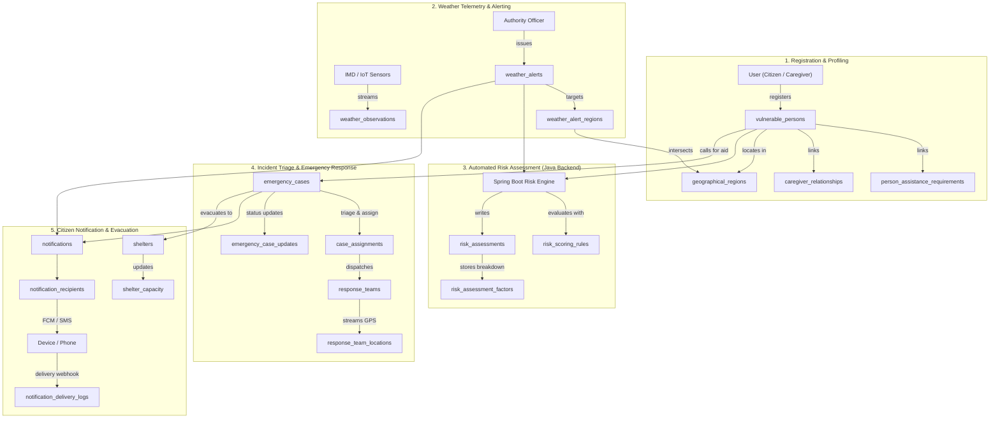

# Table Relationships & Referential Integrity Matrix
## Extreme Weather Vulnerability Identification and Emergency Response System

This document specifies all relational mappings, cardinalities, cascade constraints, and data integrity safeguards designed into the schema.

---

### 1. Relational Cardinality Overview

#### A. One-to-One (1:1) Relationships
- **`shelters` <---> `shelter_capacity`**: Each physical shelter has exactly one capacity tracking record (`uq_shelter_capacity_shelter UNIQUE(shelter_id)`). Deleting a shelter cascades to delete its capacity record.

#### B. One-to-Many (1:N) Relationships
- **`roles` ---> `user_roles`**: A single role is assigned to multiple users.
- **`users` ---> `user_sessions`**: One user can maintain multiple active mobile or web client sessions.
- **`users` ---> `emergency_contacts`**: One user can define an ordered list of personal emergency contacts.
- **`vulnerability_categories` ---> `vulnerable_persons`**: One vulnerability category classifies multiple individuals.
- **`geographical_regions` ---> `vulnerable_persons`**: An administrative region contains many vulnerable residents.
- **`geographical_regions` ---> `weather_observations`**: One region accumulates thousands of periodic telemetry observations.
- **`weather_event_types` ---> `weather_alerts`**: One threat type categorizes multiple issued alerts.
- **`risk_scoring_rules` ---> `risk_assessments`**: One algorithmic rule version governs historical risk assessments.
- **`risk_assessments` ---> `risk_assessment_factors`**: One individual risk assessment is broken down into multiple contributing score factors.
- **`emergency_categories` ---> `emergency_cases`**: One emergency category classifies multiple distress tickets.
- **`emergency_cases` ---> `emergency_case_updates`**: One emergency case maintains an immutable chronological status timeline.
- **`emergency_cases` ---> `case_assignments`**: One emergency case maintains a dispatch log across teams.
- **`emergency_cases` ---> `case_attachments`**: One emergency case holds multiple photos and files.
- **`response_teams` ---> `response_team_locations`**: One response team streams periodic GPS telemetry coordinates.
- **`response_teams` ---> `team_availability`**: One response team logs multiple availability shifts.
- **`users` ---> `device_tokens`**: One user registers multiple device tokens (e.g. tablet + phone).
- **`notifications` ---> `notification_recipients`**: One broadcast notification addresses multiple recipients.
- **`notification_recipients` ---> `notification_delivery_logs`**: One recipient dispatch logs webhook callbacks from SMS/Push providers.
- **`vulnerable_persons` ---> `consent_records`**: One vulnerable individual has multiple legal consent authorizations (location, medical, etc.).
- **`vulnerable_persons` ---> `access_logs`**: One vulnerable individual has an audit trail of every official inspection.

#### C. Many-to-Many (N:M) Relationships Through Junction Tables
1. **Users <---> Roles (`user_roles`)**:
   - `user_id` FK -> `users(user_id)` ON DELETE CASCADE
   - `role_id` FK -> `roles(role_id)` ON DELETE RESTRICT
2. **Caregivers <---> Vulnerable Persons (`caregiver_relationships`)**:
   - `caregiver_user_id` FK -> `users(user_id)` ON DELETE CASCADE
   - `person_id` FK -> `vulnerable_persons(person_id)` ON DELETE CASCADE
   - Unique constraint `uq_caregiver_person` ensures one relationship mapping per pair.
3. **Vulnerable Persons <---> Assistance Requirements (`person_assistance_requirements`)**:
   - `person_id` FK -> `vulnerable_persons(person_id)` ON DELETE CASCADE
   - `requirement_id` FK -> `assistance_requirements(requirement_id)` ON DELETE RESTRICT
4. **Weather Alerts <---> Geographical Regions (`weather_alert_regions`)**:
   - `alert_id` FK -> `weather_alerts(alert_id)` ON DELETE CASCADE
   - `region_id` FK -> `geographical_regions(region_id)` ON DELETE CASCADE
5. **Response Teams <---> Users (`response_team_members`)**:
   - `team_id` FK -> `response_teams(team_id)` ON DELETE CASCADE
   - `user_id` FK -> `users(user_id)` ON DELETE RESTRICT

---

### 2. Referential Integrity & Cascade Safety Matrix

The schema enforces strict deletion boundaries to protect legal, life-safety, and audit histories.

| Source Table | Foreign Key Column | Target Table | On Delete Action | Safety Rationale |
| :--- | :--- | :--- | :--- | :--- |
| `user_roles` | `user_id` | `users` | **CASCADE** | User removal cleans up role bindings. |
| `user_roles` | `role_id` | `roles` | **RESTRICT** | Cannot delete a system role while users hold it. |
| `user_sessions` | `user_id` | `users` | **CASCADE** | User removal wipes active auth sessions. |
| `emergency_contacts` | `user_id` | `users` | **CASCADE** | Removing user cleans up personal contact list. |
| `vulnerable_persons` | `primary_category_id` | `vulnerability_categories`| **RESTRICT** | Cannot delete a master category with registered citizens. |
| `vulnerable_persons` | `geographical_region_id`| `geographical_regions` | **SET NULL** | Re-boundarying a district does not wipe citizen profiles. |
| `vulnerable_persons` | `registered_by_user_id` | `users` | **SET NULL** | If registrar account is removed, vulnerable individual profile survives. |
| `caregiver_relationships` | `caregiver_user_id` | `users` | **CASCADE** | Removing caregiver removes caregiver link. |
| `caregiver_relationships` | `person_id` | `vulnerable_persons` | **CASCADE** | Removing vulnerable person removes links. |
| `person_assistance_requirements`| `requirement_id` | `assistance_requirements`| **RESTRICT** | Cannot delete assistance code if individuals require it. |
| `shelter_capacity` | `shelter_id` | `shelters` | **CASCADE** | Deleting shelter deletes capacity slot. |
| `weather_observations` | `region_id` | `geographical_regions` | **CASCADE** | Region deletion cleans associated telemetry. |
| `weather_alerts` | `event_type_id` | `weather_event_types` | **RESTRICT** | Cannot delete event type while active alerts reference it. |
| `risk_assessments` | `person_id` | `vulnerable_persons` | **CASCADE** | Deleting person cleans up computed assessments. |
| `risk_assessments` | `rule_id` | `risk_scoring_rules` | **RESTRICT** | Cannot delete historical rule version used in past audits. |
| `risk_assessments` | `weather_alert_id` | `weather_alerts` | **SET NULL** | Alert expiration/removal preserves assessment score. |
| `emergency_cases` | `reporter_id` | `users` | **RESTRICT** | **CRITICAL**: Deleting user account cannot erase emergency distress history! User must be soft-deleted. |
| `emergency_cases` | `affected_person_id` | `vulnerable_persons` | **RESTRICT** | **CRITICAL**: Cannot erase emergency case tickets. |
| `emergency_cases` | `category_id` | `emergency_categories` | **RESTRICT** | Cannot delete master emergency category in use. |
| `emergency_cases` | `assigned_team_id` | `response_teams` | **SET NULL** | Disbanding response team leaves incident case intact. |
| `case_assignments` | `team_id` | `response_teams` | **RESTRICT** | Prevents removing response team with active dispatches. |
| `response_team_members`| `user_id` | `users` | **RESTRICT** | Must un-roster responder before removing user profile. |
| `audit_logs` | `user_id` | `users` | **SET NULL** | User removal never deletes legal audit history. |
| `consent_records` | `consenting_user_id` | `users` | **RESTRICT** | Legal consent signatory record cannot be expunged. |
| `access_logs` | `user_id` | `users` | **SET NULL** | Internal surveillance log survives user deletion. |

---

### 3. End-to-End System Data Flow

